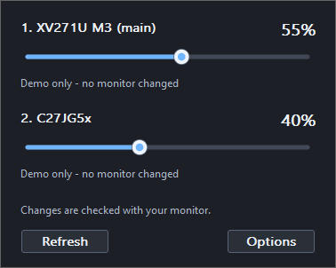
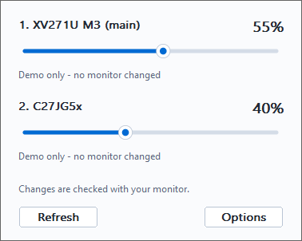

# Steady Brightness

[](https://github.com/Bauda/steady-brightness/actions/workflows/ci.yml)
[](https://github.com/Bauda/steady-brightness/releases/latest)
[](LICENSE)

**Hardware brightness sliders for your monitors, one click from the Windows tray.**

A small native Windows app designed to sit quietly beside the clock. No Electron, .NET runtime, background service, or administrator access required.

**[Download for Windows x64](https://github.com/Bauda/steady-brightness/releases/latest)** · [Troubleshooting](docs/troubleshooting.md) · [Contribute](CONTRIBUTING.md) · [Report a bug](https://github.com/Bauda/steady-brightness/issues/new/choose)

| Dark | Light |
| --- | --- |
|  |  |

## Why Steady Brightness?

- Independent **hardware** brightness for each compatible monitor, with read-back verification.
- Click a track to jump directly to that value, or drag the smooth slider.
- Light, dark, or Windows default appearance; keyboard controls and Windows UI Automation support.
- Isolated monitor helper with an approximately nine-second timeout so a stuck driver call does not block the tray.
- Event-driven operation: no periodic idle polling, network calls, telemetry, updater, animation loop, or continuous GPU rendering.
- Optional startup at sign-in, portable use, and installation for the current user.

## Install

1. Open the **[latest release](https://github.com/Bauda/steady-brightness/releases/latest)** and download `SteadyBrightness-Windows-x64.zip` under **Assets**. The automatically generated **Source code** archives are for developers.
2. Extract the ZIP, then double-click `install.cmd` in the extracted folder.
3. Click the yellow sun beside the clock. If it is inside the **^** overflow menu, drag it into the visible tray area.
4. Adjust each monitor's slider. Open **Options > Start with Windows** to enable automatic startup; it starts off.

Requires Windows 10 or 11, x64. External monitors must support DDC/CI; enable it in the monitor's own menu. Built-in panels use WMI when available. Monitor, driver, dock, and cable compatibility varies. ARM64 and 32-bit builds are not currently provided.

Release binaries are **unsigned**, so Windows may show an unknown-publisher warning. Releases include SHA-256 checksums and GitHub build provenance. See [verifying downloads](docs/install.md#verify-a-download). Never disable Windows security globally to run the app.

For portable use, run `SteadyBrightness.exe` directly. Search for **Steady Brightness** in Start after installing; its shortcut can also be pinned to the taskbar. **Keep tray icon visible** opens Windows taskbar settings, where you control visibility.

To update, exit from **Options**, extract the new release, and run `install.cmd` again. Your theme and startup preferences are retained. To uninstall, use **Windows Settings > Apps > Installed apps > Steady Brightness**.

[Full installation and removal instructions](docs/install.md)

## Low resource use

The C++ runtime is linked into the executable. The resident app waits for Windows messages; a temporary helper handles monitor access and exits when the flyout is hidden and pending changes finish. Slider drawing uses a small temporary software bitmap on repaint.

A local Windows 11 x64 validation of version 1.0.2 recorded approximately **15.1 MiB working set**, **2.3–2.4 MiB private memory**, and **0 ms recorded CPU time over 60 seconds** with the flyout hidden. These are short measurements on one machine, subject to Windows counter resolution, not a 24-hour endurance guarantee. GPU use was not separately benchmarked. See [validation and compatibility](docs/validation.md) for the limits and reproducible checks.

## If a monitor is missing

Wake it, enable DDC/CI in its on-screen menu, and press **Refresh**. Close other brightness apps while troubleshooting to avoid competing commands. Try a direct connection if using a dock or adapter. Steady Brightness cannot provide hardware brightness on every display path. It does not use a dimming overlay or alter gamma.

See the [troubleshooting guide](docs/troubleshooting.md) before [reporting a compatibility problem](https://github.com/Bauda/steady-brightness/issues/new/choose). Reports of successful setups are welcome too.

## Build and contribute

Install Visual Studio Build Tools with **Desktop development with C++**, the MSVC x64 tools, and a Windows 10/11 SDK. Then:

```powershell
git clone https://github.com/Bauda/steady-brightness.git
cd steady-brightness
.\build.cmd
.\build\SteadyBrightness.exe --demo
powershell -NoProfile -ExecutionPolicy Bypass -File .\scripts\test.ps1
```

`--demo` uses two simulated monitors and does not change hardware brightness. The tests also check helper crash/timeout isolation without writing to monitors. No package manager or downloaded build dependency is needed: public NVIDIA headers are vendored with their MIT notices.

Start with [CONTRIBUTING.md](CONTRIBUTING.md), [architecture](docs/architecture.md), and the [testing guide](docs/testing.md). Useful contributions include reproducible compatibility reports, accessibility feedback, and fixes that preserve the small idle footprint. This is an early community project; support and hardware coverage depend on contributors.

## License and security

[MIT](LICENSE). NVIDIA header notices are preserved in [THIRD-PARTY-NOTICES.txt](THIRD-PARTY-NOTICES.txt). No NVIDIA driver binaries are distributed. The sun icon is included as part of this project.

Report security vulnerabilities privately using [GitHub security advisories](https://github.com/Bauda/steady-brightness/security/advisories/new), following [SECURITY.md](SECURITY.md). General bugs belong in Issues. Participation follows the [Code of Conduct](CODE_OF_CONDUCT.md).
